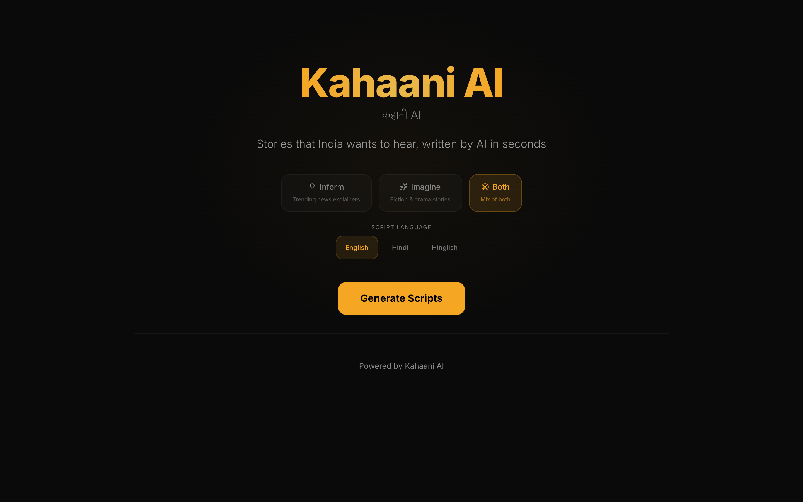
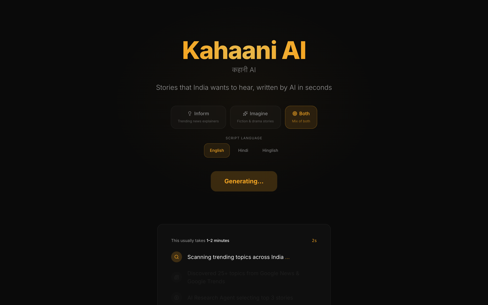
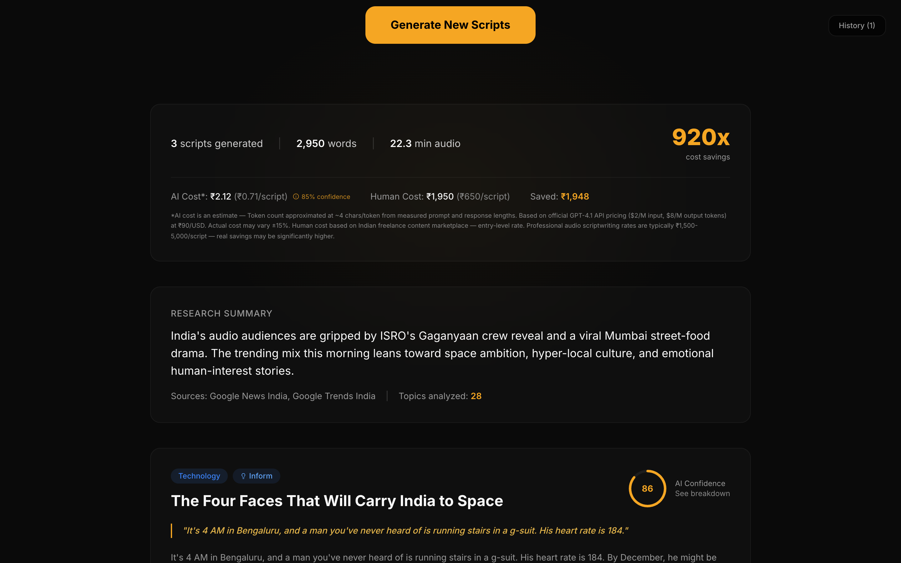
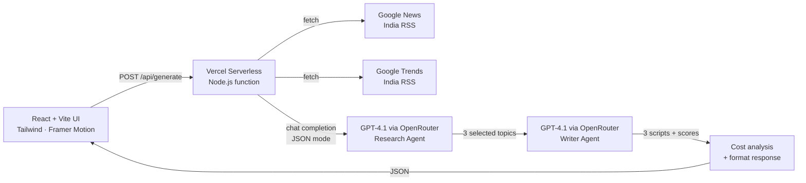

<div align="center">

# 🎙️ Kahaani AI: audio scripts for Indian audiences, written by two AI agents

**Three audio scripts in a couple of minutes, for a few rupees instead of ₹1,950 at an entry-level freelance rate.**

[](https://kahaani-ai-livid.vercel.app)
[](https://github.com/aksheyw/kahaaniAI/actions/workflows/ci.yml)
[](LICENSE)


[**→ Try the live demo**](https://kahaani-ai-livid.vercel.app)

</div>

---

I built Kahaani AI to show that the script, the bottleneck in Indian audio content, can be near-free and near-instant. You pick a mode (Inform for news explainers, Imagine for fiction, or Both) and a language (English, Hindi or Hinglish). A Research agent picks three topics, and a Writer agent writes a script for each and scores it.

<p align="center">
  
</p>

---

## What this is

A 4-day proof-of-concept built for the Indian streaming market.

Pick a mode and a language, hit Generate, and a couple of minutes later you have three audio scripts (written to an 800–1200 word brief), a short research summary, an AI Confidence score for each script, which is the Writer agent rating its own work, and a transparent cost breakdown.

This is a working product, not a deck. Open the live link and try it.

Why I built it this way, and what I left out on purpose, is in [CASE-STUDY.md](CASE-STUDY.md).

## Screenshots

<table>
<tr>
<td width="33%"></td>
<td width="33%"></td>
<td width="33%"></td>
</tr>
<tr>
<td align="center"><sub>Pick mode + language</sub></td>
<td align="center"><sub>Staged loading (Research → Write → Score)</sub></td>
<td align="center"><sub>3 scripts + cost analysis (sample data)</sub></td>
</tr>
</table>

## How it is built

<details>
<summary>🔍 <b>The numbers, and where they come from</b></summary>

<br>

| Metric | AI (this app) | Human freelancer |
|---|---|---|
| **Cost for 3 scripts** | **a few rupees**, estimated by the app on every run (₹2.85 in a live run on 16 Oct 2026) | ₹1,950 (₹650 a script) |
| **Turnaround** | **a couple of minutes** | 2–3 days |
| **AI Confidence** | The Writer agent scores its own scripts for hook strength, narrative flow, emotional engagement and audio readiness | Subjective |

Cost basis: GPT-4.1 pricing (~$2/M input, $8/M output) × measured prompt/response lengths × ₹90/USD. Human rate: ₹650 a script, an entry-level rate on Indian freelance content marketplaces (Pepper Content, Fiverr India). The cost figures are reproducible from the [`api/generate.js`](api/generate.js) cost-tracking logic, so re-run with current model rates to update.

</details>

<details>
<summary>🔧 <b>Architecture: two agents in one serverless function</b></summary>

<br>



Two-agent design: a **Research Agent** picks three topics from up to 30 news and search items, and a **Writer Agent** writes a script for each, with a self-rated AI Confidence score.

A 15-topic curated fallback kicks in if the RSS feeds return fewer than 5 items, so sparse feeds never dead-end the demo for a recruiter.


</details>

<details>
<summary>📋 <b>Engineering decisions worth calling out</b></summary>

<br>

1. **Two-agent split, not one.** A single prompt asking "pick topics + write scripts" produces shallow output. Splitting into Research Agent (picks 3 topics with rationale) → Writer Agent (writes each script and scores it) yields markedly better quality and gives the UI an honest reason to show staged progress.

2. **JSON mode + per-call timeouts.** OpenAI's `response_format: json_object` asks for a bare JSON reply, and a regex fallback for markdown-fenced replies stays as a backup. Each model call has a 75s `AbortController` timeout. ([`api/generate.js:266`](api/generate.js#L266))

3. **RSS fallback strategy.** The function tops up the list from 15 curated India-relevant topics when total feed items < 5. ([`api/generate.js:82`](api/generate.js#L82))

4. **Topic deduplication via localStorage.** Recent generations' topics are cached client-side and sent as `exclude_topics` on subsequent calls. ([`src/lib/history.js`](src/lib/history.js))

5. **Cost transparency, with confidence levels.** The cost analysis surface shows AI cost (₹), human cost (₹), savings multiplier, and an "85% confidence" badge with a footnote explaining the ±15% variance window from token-to-character estimation. Honest framing matters more than impressive numbers.

</details>

<details>
<summary>📄 <b>What I learned shipping this</b></summary>

<br>

A few notes from the build that future-me (and forkers) will appreciate:

- **Framer Motion's `initial={{ opacity: 0 }}` won't fire on background tabs.** Cosmetic only, but it tripped up automated visual testing.
- **Mobile responsive on a Motorola Razr (280px outer display) was the hardest viewport.** Solved with `flex-wrap` on button rows, `flex-col sm:flex-row` on data rows, and 44px+ touch targets via `py-3` on language pills.
- **OpenAI JSON mode requires the word "JSON" somewhere in the messages.** Without it, the API errors out. Documented in the OpenAI changelog but easy to miss.
- **Token cost estimation via character count has a ±15% variance.** I disclose this in the UI rather than pretending the number is exact. Honest is better than impressive.

</details>

<details>
<summary>📦 <b>Tech stack, running it locally and deploying your own</b></summary>

<br>

| Layer | Choice | Why |
|---|---|---|
| Frontend | **React + Vite** | Fastest path to a polished SPA. Vite's dev experience is unmatched for portfolio work. |
| Styling | **Tailwind CSS** | Dark, premium aesthetic. Glass-morphism cards, custom gold accent. |
| Animation | **Framer Motion** | Staged loading transitions and AnimatePresence for smooth result reveals. |
| Icons | **Lucide React** | Consistent SVG icon system. |
| Backend | **Vercel Serverless (Node.js)** | One-file backend. No infra to manage. Auto-scales. |
| AI | **OpenAI via OpenRouter** with `response_format: json_object` | OpenRouter gives one billing surface for any model + reliable structured output. This build uses GPT-4.1, set as a constant in `api/generate.js`. |
| Hosting | **Vercel** | Auto-deploy from `main`. Edge network. 180s function budget. |

**Run locally**

```bash
git clone https://github.com/aksheyw/kahaaniAI.git
cd kahaaniAI
npm install

# Add your OpenRouter key (get one at https://openrouter.ai/keys)
echo "KAHAANI_AI_OPENROUTER_API_KEY=sk-or-v1-your-key-here" > .env

# Start the Vercel dev server (runs both Vite + serverless functions)
npx vercel dev
# OR frontend-only with a custom backend:
# echo "VITE_API_URL=https://your-backend.example.com" >> .env.local
# npm run dev
```

Visit `http://localhost:3000` (Vercel dev) or `http://localhost:5173` (Vite dev).

**Deploy your own**

1. Fork this repo.
2. Import into Vercel, which auto-detects Vite + the `api/` folder.
3. Add one environment variable: `KAHAANI_AI_OPENROUTER_API_KEY` (your OpenRouter key).
4. (Optional) `ALLOWED_ORIGIN` to lock down CORS to your domain.
5. Push to `main`, and Vercel auto-deploys.

**Project structure**

```
kahaaniAI/
├── api/
│   ├── generate.js      # Vercel serverless function: full pipeline in 296 lines
│   └── health.js        # /api/health: deployment liveness check
├── src/
│   ├── App.jsx          # Top-level state, generation flow, history management
│   ├── components/
│   │   ├── Hero.jsx              # Mode + language selectors
│   │   ├── LoadingStages.jsx     # Animated 5-stage progress
│   │   ├── ResultsSummary.jsx    # Cost + totals strip
│   │   ├── ScriptCard.jsx        # Per-script card with expandable script text
│   │   ├── ConfidenceScore.jsx   # Circular score + breakdown
│   │   └── HistoryDrawer.jsx     # localStorage history with restore
│   └── lib/history.js            # Persistent topic dedup + history
├── docs/
│   ├── architecture.md           # Engineering deep-dive
│   └── screenshots/              # Embedded above
└── vercel.json          # Function config: 180s timeout
```

</details>

## License

[MIT](LICENSE). © 2026 Akshey Walia

---

<div align="center">

**Built by [Akshey Walia](https://www.linkedin.com/in/aksheywalia/)** · [LinkedIn](https://www.linkedin.com/in/aksheywalia/) · [aksheywalia.in](https://aksheywalia.in)

*Senior Product Leader · Consumer Platforms at 250M+ Device Scale · AI Product Building · 0-to-1*

</div>
